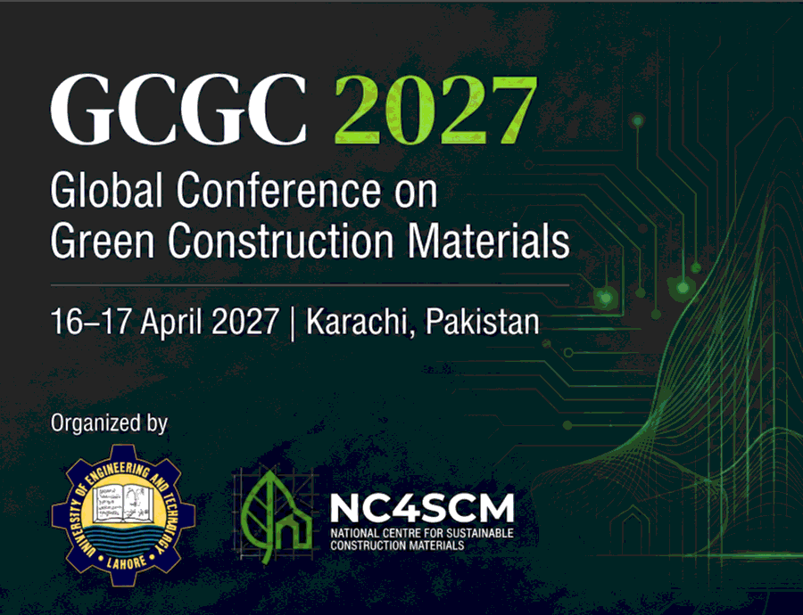
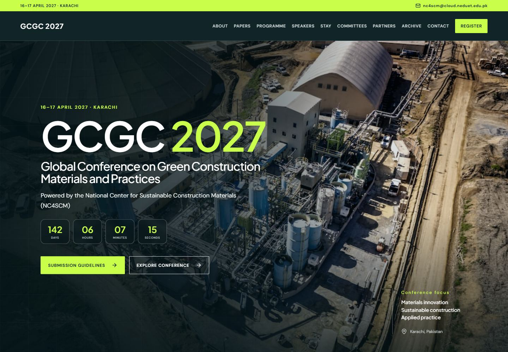
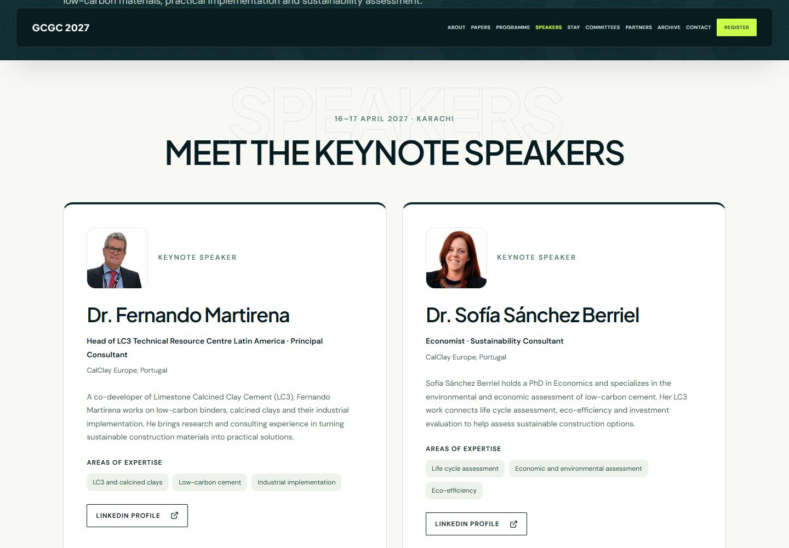
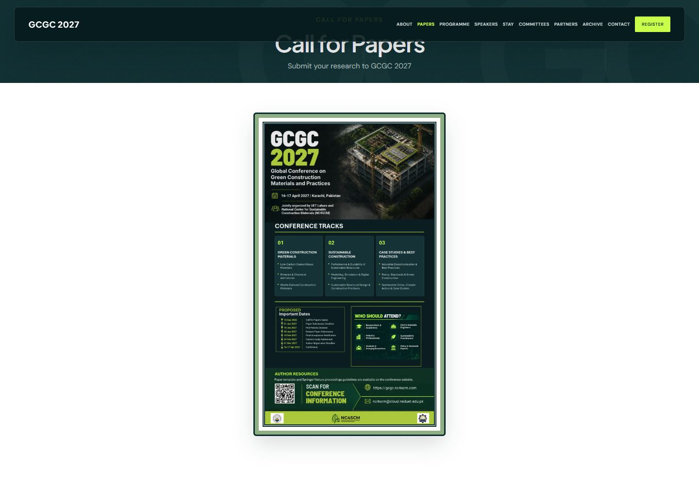
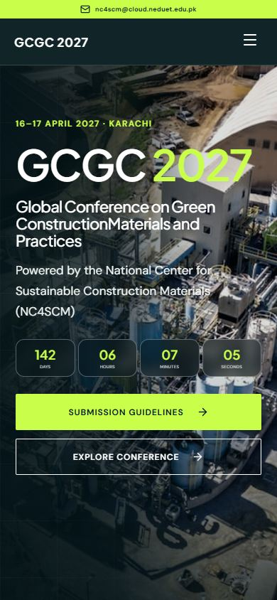

<div align="center">



# GCGC 2027
### Global Conference on Green Construction Materials and Practices

**16–17 April 2027 · Karachi, Pakistan**
Powered by the National Center for Sustainable Construction Materials

[](package.json)
[](package.json)
[](package.json)
[](package.json)
[](vercel.json)
[](scripts/sync-keynotes.mjs)

[**🌐 Visit website**](https://gcgc.nc4scm.com) · [**📄 Call for Papers**](https://gcgc.nc4scm.com/call-for-papers) · [**🎤 Speakers**](https://gcgc.nc4scm.com/speakers) · [**✉ Contact**](https://gcgc.nc4scm.com/contact)

</div>

---

## A conference platform for greener construction 🌱

A public information website connecting materials research, sustainable construction and applied practice. Explore **3 conference tracks**, **9 research areas**, author resources, keynote profiles and the **GCGC 2025 archive**.

> **Checkpoint · 24 November 2026:** application source reviewed at `df08a48`. Programme, fees, final venue/address, committees, partners, accommodation and the dedicated submission URL still need organizer confirmation. Live deployment and enquiry delivery are not certified by this README. Screenshots below show a local preview of the inspected source.

## Website preview 🖼️



| Keynote speakers | Call for Papers |
| --- | --- |
|  |  |

<details>
<summary>📱 Mobile homepage preview</summary>



</details>

*Captured from the current source build for this handover; see [capture provenance](docs/screenshots/README.md). Images are previews of implementation, not evidence of production availability.*

## Start here 🧭

| Reader | Guide |
| --- | --- |
| Next AI assistant / project owner | [Project handover](docs/PROJECT-HANDOVER.md) · [Pasteable resume prompt](docs/RESUME-HERE.md) |
| Developer | [Developer guide](docs/DEVELOPER-GUIDE.md) · [Combined PDF](docs/GCGC_2027_Handover.pdf) · [Check and delivery status](docs/DELIVERY-STATUS.md) |
| Visitors / organizers | [User manual](docs/USER-MANUAL.md) |
| Release maintainer | [Historical security, privacy and SEO audit](docs/SECURITY-PRIVACY-SEO-AUDIT.md) |

## Quick start ⚡

```bash
npm ci --ignore-scripts
npm run dev
```

Node **>=22.12.0** is required; CI uses Node 24. No frontend secret, custom database or standalone conference Sanity Studio is needed. Most conference content is maintained in source; keynote text is read from the public NC4SCM Sanity event during builds with a reviewed fallback.

---

Official website for the **Global Conference on Green Construction Materials and Practices (GCGC 2027)**, powered by the National Center for Sustainable Construction Materials (NC4SCM).

- Live website: [gcgc.nc4scm.com](https://gcgc.nc4scm.com)
- Conference dates: **16–17 April 2027**
- Conference city: **Karachi, Pakistan**
- Official email: **nc4scm@cloud.neduet.edu.pk**

---

## 1. Website Guide for Clients and Visitors

### About the website

The website is the public information centre for GCGC 2027. It introduces the conference, presents its research areas, supports paper preparation, communicates important dates, and provides information for speakers, delegates, partners and prospective authors.

The interface is fully responsive and designed for desktop computers, tablets and mobile phones. It includes animated content, accessible navigation, downloadable author resources, a live conference countdown and photographs from GCGC 2025.

### Website pages

| Page | Purpose |
| --- | --- |
| Home | Conference introduction, countdown, tracks, dates, institutions and 2025 highlights |
| About | Purpose, values and connection between research, industry and climate action |
| Call for Papers | Research tracks, submission workflow, requirements and downloadable author files |
| Programme | Two-day programme layout ready for confirmed sessions and speakers |
| Speakers | Keynote biographies, expertise, portraits and LinkedIn links |
| Registration | Registration categories and policies ready for confirmed fees |
| Accommodation | Formal information for delegate accommodation support in Karachi |
| Committees | Conference governance and committee categories |
| Partners | Partnership opportunities and space for confirmed organizations |
| Archive | Interactive GCGC 2025 gallery and conference information |
| Contact | Conference details and an enquiry form connected to the official email |

### Conference research tracks

The programme is organized into three main tracks and nine research areas:

1. **Green Construction Materials**
   - Low-Carbon Cementitious Materials
   - Minerals and Chemical Admixtures
   - Waste-Derived Construction Materials
2. **Sustainable Construction**
   - Performance and Durability of Sustainable Structures
   - Modelling, Simulation and Digital Engineering
   - Sustainable Structural Design and Construction Practices
3. **Case Studies and Best Practices**
   - Industrial Decarbonisation and Best Practices
   - Policy, Standards and Green Construction
   - Sustainable Cities, Climate Action and Case Studies

### Available downloads

- GCGC paper template (`DOCM`)
- Springer Nature proceedings guidelines (`PDF`)

These files are available from the Home page, Call for Papers page and footer.

### Information awaiting confirmation

Some areas intentionally use professional preview content until official details are approved:

- EasyChair submission URL
- Final conference venue and complete address
- Additional speakers, approved portraits and keynote session titles
- Detailed programme sessions and timings
- Registration fees and payment policies
- Committee member names and affiliations
- Confirmed partner logos
- Accommodation hotel, eligibility and reservation details

Only approved information should replace these placeholders. Dates, names, fees and links should never be guessed.

### Requesting a website update

When sending content to the developer, clearly identify:

1. The page and section to update.
2. The exact approved text.
3. Any link, document, logo or photograph required.
4. Whether older content should be replaced or retained.
5. The person who approved the change.

For images, provide the highest-quality original files and usage permission. Transparent PNG or SVG files are preferred for logos.

---

## 2. Developer and Maintenance Guide

### Technology

- React and TypeScript
- Vite
- React Router
- Framer Motion
- Lucide React icons
- Vercel Speed Insights
- Custom responsive CSS
- Vercel deployment

The project is a client-side React single-page application with multiple public routes. The build generates one HTML entry document per approved route, with route-specific metadata. Vercel rewrites only those known routes to their documents. Unknown URLs receive a real 404 response and an accessible missing-page view. The React application and approved page content are retained.

### Project structure

```text
.
├── index.html                 # Global metadata, canonical URL and Event schema
├── public/
│   ├── downloads/             # Author template and proceedings guidelines
│   ├── images/                # Conference images and institutional logos
│   ├── google6cebf148146998e0.html
│   ├── robots.txt
│   └── sitemap.xml
├── src/
│   ├── App.tsx                # Layout, components, pages and routes
│   ├── data.ts                # Navigation, dates, tracks and shared data
│   ├── main.tsx               # React application entry point
│   └── styles.css             # Global and responsive styling
├── vercel.json                # Generated route rewrites and security headers
└── package.json
```

### Local development

Requirements: a current Node.js LTS release and npm.

```bash
npm ci
npm run dev
```

Create a production build before every pull request:

```bash
npm run build
npm run preview
```

### Content maintenance

- Update conference dates, navigation and research tracks in `src/data.ts` where applicable.
- Page content and route components live in `src/App.tsx`.
- Keynote profiles are read from the existing NC4SCM public Sanity dataset at build time by `scripts/sync-keynotes.mjs`; the reviewed `src/conference-content.json` snapshot keeps builds usable during CMS outages. The GCGC conference website itself is a static React/Vite site and does not have a separate poster CMS or Sanity Studio.
- The Call for Papers poster is a static repository asset. Replace `public/images/gcgc-2027-poster.webp` with the approved full-size artwork (keep the same filename and WebP format), commit it, and redeploy. The page links directly to that local file in a new tab and preserves its original aspect ratio. If the file is absent or fails to load, an accessible placeholder appears instead of a broken image.
- Conference dates remain release-controlled in the application, metadata and JSON-LD. Update all of them together, including the sharing banner and main NC4SCM event/announcement.
- Add other static site images under `public/images/` and reference them as `/images/filename.ext`.
- Add downloads under `public/downloads/` and reference them as `/downloads/filename.ext`.
- Add new public routes to both the `nav` array and `<Routes>` configuration.
- Add route titles and descriptions to `src/page-meta.json`. Run the build and commit the generated `vercel.json` and `public/sitemap.xml` alongside route changes.
- Test navigation, direct route loading and responsive layouts after every change.

### SEO and crawler configuration

SEO infrastructure is intentionally separated from visible page design:

- `index.html`: homepage metadata and Event JSON-LD; `src/page-meta.json` supplies metadata for every public route
- `scripts/build-pages.mjs`: route documents, matching sitemap, exact JSON-LD CSP hash and allowlisted rewrites
- `public/robots.txt`: crawler access and sitemap location
- `public/sitemap.xml`: canonical public routes
- `public/google6cebf148146998e0.html`: Google Search Console ownership verification

Do not add large keyword blocks to the visible hero or alter approved interface copy solely to satisfy automated audit tools. React SPAs may generate false warnings when a crawler does not execute JavaScript.

### Critical safety rules

1. **Never delete, rename, move or edit** `public/google6cebf148146998e0.html`.
2. Preserve the catch-all React route in `src/App.tsx` as the accessible `NotFound` view.
3. Preserve route-specific rewrites and generated HTML entries. Do not restore a catch-all rewrite: it causes soft 404s and loses page-specific first-response metadata. This intentionally replaces the earlier homepage fallback to meet the security and indexing audit requirements.

4. Preserve existing security headers when editing `vercel.json`.
5. Do not publish unconfirmed names, fees, URLs, hotels or venue addresses.
6. Do not reuse one conference photograph in multiple visible sections unless requested.
7. Maintain responsive behaviour across desktop, tablet and mobile breakpoints.
8. Run `npm run build` and inspect `git diff` before committing.

### Forms and external services

The contact form submits through FormSubmit to the official conference email. Its default CAPTCHA is enabled and the honeypot is retained. Native validation, length limits and whitespace checks run locally; FormSubmit handles the external spam check and result page. Provider activation, server-side protections and real mailbox delivery require organizer verification. Do not send test mail without explicit authorization. The EasyChair portal remains a placeholder until the conference team supplies the official submission URL.

No application database or custom backend is currently required. Add one only when a confirmed feature cannot be handled safely by the existing static architecture.

### Deployment workflow

The production website is connected to the repository through Vercel.

1. Create a focused feature or fix branch.
2. Make the smallest necessary change.
3. Run the production build and responsive checks.
4. Open a pull request describing content and technical changes.
5. Merge only after validation.
6. Vercel deploys the updated `main` branch automatically.
7. Verify the live homepage and any changed interior routes after deployment.

### Recommended pre-merge checklist

- [ ] Production build passes
- [ ] Desktop, tablet and mobile layouts checked
- [ ] Navigation and active states work
- [ ] Direct interior-page reload works
- [ ] Dates and venue details are consistent
- [ ] Downloads and external links work
- [ ] Images include meaningful alternative text
- [ ] No approved content was unintentionally removed
- [ ] Google verification file is unchanged
- [ ] Known routes load directly; missing URLs return HTTP 404; security headers are intact
- [ ] Sitemap includes any new public route

### Current production status

The website includes the approved Karachi dates, research tracks, author downloads, conference archive, institutional identities, enquiry form, technical SEO files, security headers and accommodation information structure. Placeholder areas should be updated progressively as the organizing team confirms final content.


## Security, privacy and release verification

Read [the audit and handover](docs/SECURITY-PRIVACY-SEO-AUDIT.md) before merging or publishing. It records evidence, remaining account checks, client decisions and rollback steps. The baseline live deployment is separate from the proposed branch; a passing local test is not a production verification.

```bash
npm ci
npm run typecheck
npm run lint
npm run build
npm run check
npx playwright install chromium
npm run test:browser
npm audit --audit-level=moderate
```

The build updates `vercel.json` and `public/sitemap.xml` deterministically. Commit those generated changes before deployment. CI fails if they drift, because Vercel reads routing configuration before running the build. `npm run serve:check` serves built route files with the configured headers for local verification; it is a test harness and does not replace a Vercel preview check. `npm run preview` uses Vite's SPA fallback and cannot verify deployment 404 behavior.

Privacy settings are in the footer and Cookies page. Performance monitoring is off by default and only activates after a saved permission; the site needs no intrusive banner. Withdrawal reloads the page to unload the optional script. Preferences expire after 180 days. Fonts are hosted locally with their licenses in `public/fonts/`. No registration, payment or account integration has been introduced. Keynote profiles use a public, build-time Sanity read with a reviewed local fallback.
